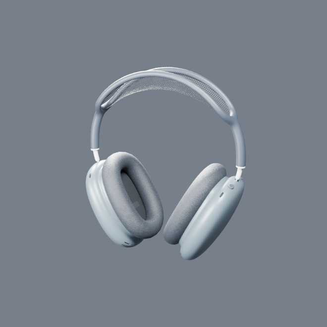

# AirPods Max 4K — Blender asset review

These previews are generated from **the file uploaded by the repository owner**, `/airpods-max-4k.glb`. They are **not** renders of the old procedural headset.

## Three approval views

### 01 — Complete model

### 02 — Cushion fabric and aluminum surface

### 03 — Woven headband canopy

## Source-model technical audit

- Source filename: `airpods-max-4k.glb`
- Input size: **14,582,076 bytes**
- Geometry: **46,640 triangles**, **one mesh**, **one material**
- Textures: **four embedded 4096 × 4096 PNGs**
- Texture roles: base color, metal/roughness, normal, specular
- Render engine: **Blender Cycles**, physically based lighting
- The source is **not split by part**. Individual cup/hinge/cushion explosions require mesh separation or a different source model. Camera-only macro closeups are possible without changes.
- These JPEG images are compressed previews of three 960 × 960 Blender renders. The downloaded source model in `main` remains unchanged.

## Licensing and credit

Model selected from a free Sketchfab listing, [AirPods Max (DJM)](https://sketchfab.com/3d-models/airpods-max-3400db28f6da41d08304ff20b29c3883). Verify that the actual uploaded model originates from the same listing and follow its Creative Commons attribution requirements before commercial publication.

**Review branch only**; the live Next.js application was not modified.
